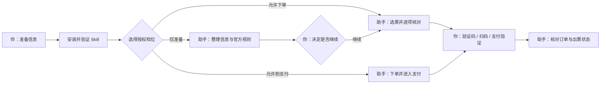

# 大麦购票助手 Skill

当前版本：v0.2.0（2026-11-11） · 最新发布与安装包见 [Releases](../../releases) · 更新历史见 [CHANGELOG.md](CHANGELOG.md)

给 Codex 等 AI 宿主使用的中文购票协作指引，帮助你按「确认场次 → 登录 → 选择票档 → 核对订单 → 支付 → 确认出票」的顺序操作大麦。

**它是一份让 AI 按规定做事的 Skill，不是安装后自行抢票的软件。** 仓库不附带独立抢票程序、服务器或浏览器驱动。仅安装这份 Skill 不需要 Python、Node.js 或云服务器；实际网页操作还需要你的宿主环境提供可用、已授权的浏览器控制工具。只有 Skill、没有浏览器工具时，助手可以整理购票信息和指导你操作，不能替你点击网页。

登录、验证码、实名认证、扫码及支付验证可能需要你本人完成。能否买到票取决于实时库存、平台规则和订单状态，这份 Skill 不保证抢票成功或全程无人值守。

## 目录

1. [快速开始](#快速开始)
2. [先了解它会做什么](#先了解它会做什么)
3. [流程概览](#流程概览)
4. [安装前准备](#安装前准备)
5. [安装 Skill](#安装-skill)
6. [先验证安装，不下单](#先验证安装不下单)
7. [开始使用](#开始使用)
8. [哪些时候需要你操作](#哪些时候需要你操作)
9. [常见问题](#常见问题)
10. [更新与卸载](#更新与卸载)
11. [仓库内容与验证范围](#仓库内容与验证范围)
12. [参与改进](#参与改进)

## 快速开始

1. 打开本仓库的 [Releases 页](../../releases)，下载最新版的 damai-ticket-assistant-vX.Y.Z.zip。
2. 解压后把整个 damai-ticket-assistant 文件夹放到个人 Skill 目录：Windows 为 %USERPROFILE%\.agents\skills，macOS / Linux 为 ~/.agents/skills。
3. 重启宿主环境，发送[安装验证模板](examples/request-template.md)，确认 Skill 被读取且助手如实报告浏览器工具能力。
4. 验证通过后，再用「只做准备」模板核对信息；确需下单时，才使用带授权范围的模板。

详细说明和备选安装方式见下文。

## 先了解它会做什么

| 工作 | 助手能做什么 |
| --- | --- |
| 买票前 | 整理场次、人数、票档、预算和备选方案，检查信息是否缺失 |
| 进入大麦后 | 在工具与平台允许时，查找活动、读取规则、选择符合要求的票 |
| 提交订单前 | 核对活动、时间、数量、观演人、票档或座位、费用和总价 |
| 提交与支付 | 在你明确授权的范围内继续操作；需要身份或支付验证时交给你完成 |
| 完成后 | 区分「已下单未支付」「支付结果待确认」「已支付待出票」和「已出票」 |
| 发生异常 | 先检查现有订单，避免因为页面超时重复下单或重复付款 |

助手会遵守排队、限购和平台限制。遇到验证码或平台拒绝自动化时，会交给你处理，不提供绕过验证或队列的方法。

## 流程概览



灰色地带一目了然：选票和核对是助手的活，登录、验证码、扫码、支付验证永远是你的活。

## 安装前准备

你需要：

1. 能够使用 Skill 的宿主环境（Codex，或其他支持 `.agents/skills` 目录规范的 AI 宿主）。
2. 本仓库是公开仓库，下载和查看不需要任何 GitHub 权限；如需用安装器自动安装，该安装器需要能访问 GitHub。
3. 如需实际操作网页，准备好宿主环境中可用的浏览器控制工具，并允许它访问大麦。
4. 如需购票，准备好自己的大麦账号和平台要求的观演人资料。

**不要在对话中发送大麦密码、完整身份证号、支付密码或验证码。** 这些信息只在相应官方登录页或表单中输入。

## 安装 Skill

任选下面一种方法即可，避免重复安装。

### 方法 A：使用 Releases 安装包（推荐）

1. 打开本仓库的 [Releases 页](../../releases)。
2. 下载最新 Release 附件中的 damai-ticket-assistant-vX.Y.Z.zip。这个压缩包解压后顶层就是 damai-ticket-assistant 文件夹，不需要自己挑目录层级。
3. 解压，把整个 damai-ticket-assistant 文件夹复制到个人 Skill 目录：

| 系统 | 个人 Skill 文件夹 | 安装后的关键文件 |
| --- | --- | --- |
| Windows | `%USERPROFILE%\.agents\skills` | `%USERPROFILE%\.agents\skills\damai-ticket-assistant\SKILL.md` |
| macOS / Linux | `~/.agents/skills` | `~/.agents/skills/damai-ticket-assistant/SKILL.md` |

Windows 用户可以把 `%USERPROFILE%\.agents\skills` 粘贴到文件资源管理器的地址栏；`%USERPROFILE%` 表示你的用户文件夹。macOS 的访达可以通过「前往文件夹」打开 `~/.agents/skills`。缺少 skills 文件夹时自行新建即可。

正确的层级：

```text
.agents/
└── skills/
    └── damai-ticket-assistant/
        ├── SKILL.md
        ├── agents/
        └── references/
```

### 方法 B：让宿主的安装器帮你安装

如果你的宿主提供 Skill 安装器（如 Codex 的 `$skill-installer`），在对话中发送：

请使用安装器（如 $skill-installer），从 GitHub 仓库 jw070322-svg/damai-ticket-assistant-skill 安装 Skill，目录为 skills/damai-ticket-assistant。请使用当前环境已经授权的 GitHub 访问方式；不要让我在对话中粘贴密码或令牌。完成后告诉我实际安装位置。

安装器可能根据宿主环境管理安装位置，以安装器报告的实际结果为准，不要再复制一份到其他目录。

### 方法 C：下载仓库 ZIP 手动复制（备选）

1. 打开本仓库，点击绿色 Code 按钮，选择 Download ZIP。
2. 解压后进入仓库文件夹，找到 skills 文件夹。
3. 复制其中**整个 damai-ticket-assistant 文件夹**（不要只复制 SKILL.md，也不要把整个仓库当成 Skill），放到上方表格中的个人 Skill 目录。

注意不要多套一层文件夹。装完若宿主没有自动发现，重启宿主后再试。

## 先验证安装，不下单

开启一个对话，发送 [模板一：只验证安装](examples/request-template.md)。

符合预期的回答应当同时包含：

- 能复述 Skill 要求准备的信息类别：演出链接与场次、数量与票档、预算上限、观演人、授权范围与截止时间；
- 能明确说当前环境有没有可用的浏览器控制工具，没有时说明只能做准备和人工指引；
- 主动声明本次不登录、不创建订单、不支付。

如果它只回答「好的，我可以帮你买票」之类的泛泛承诺，说明 Skill 没有被真正读取，请按下方 FAQ 排查。这一步成功代表 Skill 能被读取，**不代表已验证大麦实时购票流程或支付流程**。

## 开始使用

建议先用「只准备」模式把信息核对清楚；需要下单时再说明授权范围。完整模板（安装验证、仅准备、仅下单、下单并支付、异常核查、停止操作共六个）统一在 [examples/request-template.md](examples/request-template.md)，复制后把方括号内容换成你的信息即可。

下面是一个「授权范围内购票」的精简示例：

请使用大麦购票助手帮我购票。活动官方链接：[大麦活动链接]；指定场次：[日期、时间、城市]；数量：[2] 张，必须一次买齐；票档优先顺序：[第一选择、第二选择]；座位要求：[必须连座]；观演人：[使用我在官方页面确认过的已保存观演人，不在聊天中发送证件号]；总预算上限：[金额] 元，包含全部费用；授权截止时间：[年月日时分，北京时间]。我授权你在以上条件内创建订单并继续到支付，最多成功 1 单。需要扫码、支付密码或验证码时由我在官方页面完成；条件变化或超预算时，先展示变化并等我确认；提交或支付结果不明确时，先查现有订单，不要重复提交。

说明：`$damai-ticket-assistant` 是 Codex 的点名调用写法；其他宿主直接说「使用大麦购票助手 Skill」即可，效果等同。

## 哪些时候需要你操作

| 情况 | 你需要做什么 |
| --- | --- |
| 登录、扫码或短信验证 | 在大麦官方页面或官方 App 中完成 |
| 验证码、实名认证 | 按平台要求亲自完成，再让助手继续核对 |
| 缺少观演人资料 | 在大麦官方表单中添加或确认，不把证件信息发到聊天 |
| 支付验证 | 在官方支付界面扫码、确认或验证身份 |
| 只支持 App 购票 | 转到官方 App；当前环境没有相应控制能力时，由你操作 |
| 超预算、换场次或改变数量 | 对助手展示的具体变化作出决定 |

购票开始后请保持在线。库存和付款期限会变化，超过期限可能需要重新选择。以平台当前显示的时间和状态为准。

## 常见问题

### 宿主找不到这个 Skill

检查三件事：SKILL.md 是否直接位于 damai-ticket-assistant 文件夹中；该文件夹是否在宿主支持的 Skill 目录；重启宿主后在对话中点名 Skill 再试。仍不行时，发送以下诊断请求，把结果与预期对照：请报告你找到的 damai-ticket-assistant 的 SKILL.md 完整路径、文件开头 frontmatter 中的 name 字段，以及 references 目录下有哪些文件。

### 打开仓库或下载显示 404 / 失败

本仓库是公开仓库，404 通常是你本地的网络问题：换网络、关代理或稍后重试。安装器下载失败时，改用浏览器直接下载 Release 安装包即可。

### 如何确认我安装的是哪个版本、是不是最新

安装包文件名、README 顶部的「当前版本」行、Skill 文件夹内 agents/openai.yaml 的 version 字段三处一致，即为你手里的版本。最新发布见 [Releases 页](../../releases)。更新时下载新版安装包完整替换旧文件夹即可。

### Skill 已安装，但助手不能打开或点击网页

Skill 提供操作规则，不提供浏览器工具。先让助手检查当前环境是否具备浏览器控制能力。没有时，仍可让它整理购票计划和核对你提供的信息，实际网页步骤由你完成。

### 出现验证码、二维码或只能在 App 购买

按官方流程亲自处理。不要尝试绕过验证码、排队或 App 限制。

### 没票、票档消失或总价变化

助手只能使用你事先允许的备选方案。没有符合条件的票时会报告结果；它不能创造库存，也不会为了买到票自行提高预算或更换日期。

### 点过提交或支付，但页面报错了

先检查订单记录和支付状态。页面超时不代表下单失败，支付返回页也不能单独证明出票成功。在状态未确认前，不要再次提交或付款，也不要让另一个对话同时购买相同目标。可使用模板五「检查已有订单或异常支付」。

### 想停止、取消订单或退款

「停止助手」只停止后续操作，不会自动取消订单。取消和退款是另外的操作，应先查看现有订单及该活动的规则，再明确提出要求。已经支付也不等于可以随时退款。可使用模板六「停止后续操作」。

## 更新与卸载

**更新：** 先结束正在进行的购票，确认没有待查的订单或支付；到 Releases 页对比最新版本号与 README 顶部「当前版本」行；下载新版安装包，完整替换旧的 damai-ticket-assistant 文件夹；重新做一次无下单验证。也可以让宿主的安装器按原安装位置协助更新；如果安装器不支持更新，就完整替换，不要另装一份。

**卸载：** 在没有正在运行的购票时，只移除你安装的 damai-ticket-assistant 文件夹，或使用宿主提供的卸载功能。不要删除整个 `.agents` 或 `skills` 文件夹。卸载不会取消已有大麦订单、撤销付款或自动登出官方账号。

## 仓库内容与验证范围

| 路径 | 用途 |
| --- | --- |
| `README.md` | 本说明：安装、准备、使用和排错 |
| `READ.md` | 兼容旧链接的说明入口，内容以 README.md 为准 |
| `CHANGELOG.md` | 每个版本的变更记录 |
| `skills/damai-ticket-assistant/` | 需要安装的完整 Skill 文件夹（SKILL.md、恢复规则、宿主元数据） |
| `examples/request-template.md` | 可复制修改的六个中文请求模板 |
| `docs/RELEASE.md` | 维护者用的发布流程（普通用户无需关心） |
| `scripts/`、`.github/` | 发布与校验自动化（普通用户无需安装） |
| `LICENSE` | MIT 许可证 |

本仓库交付检查针对文件结构、说明内容和 Skill 的静态规则。**未使用你的真实账号进行下单或支付，也未完成真实库存、验证码、支付渠道或出票流程的端到端验证。** 大麦页面、平台规则和宿主工具能力可能变化，实际运行应重新读取当前界面，并在信息不明确时停止进一步提交。

即使仓库公开，也不要把账号密码、浏览器登录状态、身份证信息、支付记录截图或入场二维码提交到仓库或贴进 Issue。

## 参与改进

- 发现大麦页面或规则变化导致 Skill 指引过时：用 Issue 模板「大麦平台变化反馈」，这是对本项目最有价值的反馈。
- Skill 行为与文档不符、步骤走不通：用「Bug 报告」模板。
- 新模板、新场景：用「功能建议」模板（请先确认建议不涉及绕过平台限制）。
- 直接提 PR 也可以，模板中附有自查清单（不弱化安全约束、同步 CHANGELOG、不含敏感信息）。

## 许可证

[MIT](LICENSE)
